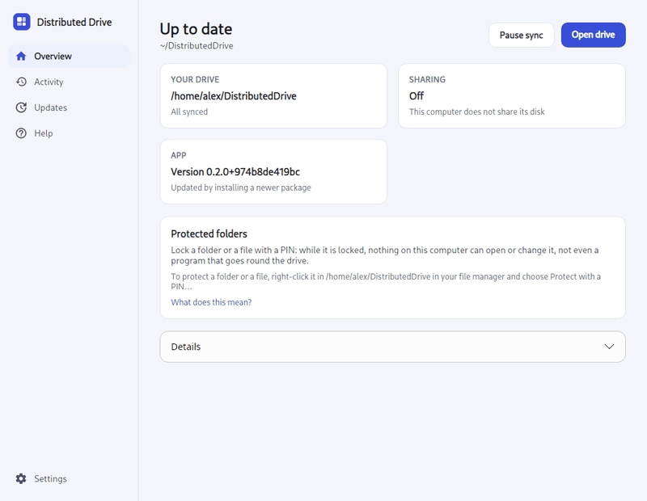
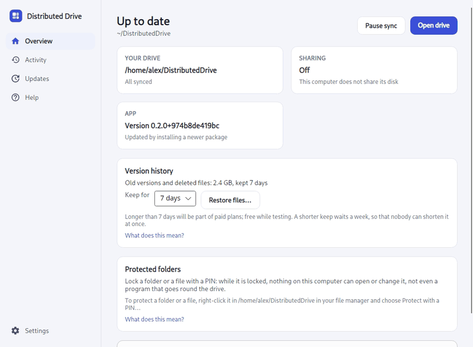
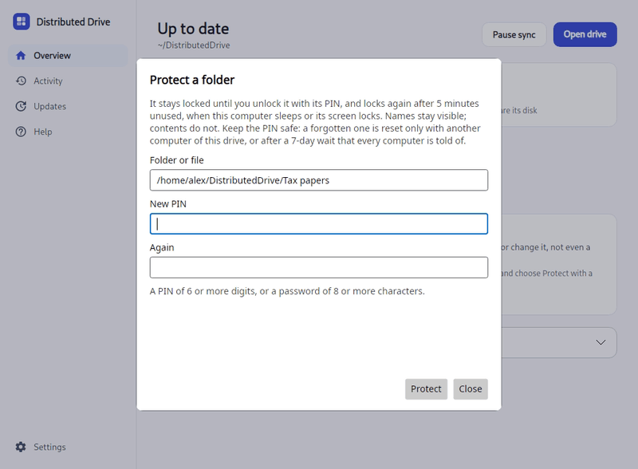

# Distributed Drive help

English · [简体中文](zh-Hans.md)

The same help is in the app: Status › Help.

## Contents

- [Your drive](#drive)
- [Pausing sync](#sync-pause)
- [Always keep on this computer / Free up space](#keep-free)
- [Sharing disk space](#sharing)
- [Turning sharing off or removing a disk](#leaving-disk)
- [How other computers reach yours](#relay)
- [Re-storing old files in bigger blocks](#repack)
- [Version history](#versions)
- [Ransomware protection](#ransomware)
- [Protected folders](#protected-folders)
- [Keep your files safe](#keep-safe)
- [Your recovery secret](#recovery-secret)
- [Monthly restore check](#restore-check)
- [Updates](#updates)
- [Problem reports and diagnostics](#diagnostics)
- [Your privacy](#privacy)
- [Language](#languages)
- [Common questions](#faq)

## Your drive

**Your drive is a folder (on Windows, a drive letter) where your files live. They are encrypted on this computer and stored on computers that share storage, so you can open them on any computer of yours. Files you open take some room on this computer's disk.**

On Windows your drive shows in File Explorer as "Distributed Drive", with its own drive letter. On Linux it is the folder you chose in the setup ("Where your files appear"). Use it like any other folder.

**What happens when you save.** A file is saved on this computer first, so you can go on working at once. It is then encrypted and uploaded. Each file is stored as two copies on two different computers (or in parts, of which some are enough to read it). The tray says "Up to date" when nothing waits. Some screens call the stored side of your drive "your vault".

**Online only, or on this computer.** Every file shows in the folder, but only the files you open are downloaded. A copy of what you open stays on this computer, up to a tenth of the disk (at least 2 GB, at most 50 GB). When that fills up, the copies used longest ago go first, and those files are online only again: opening one downloads it.

- Windows: in File Explorer's Attributes column, "O" marks a file that is online only, "P" one kept on this computer.
- GNOME Files shows a cloud on files that are online only and a check on kept ones.

## Pausing sync

**Pause sync stops this computer sending its changes until you resume. Your files stay usable here, and your saves wait safely on this computer. Nothing is lost, but your other computers do not see your changes until you resume.**

Choose **Pause sync** in the app's menu (on Windows, right-click the Distributed Drive icon next to the clock; on Linux, click its icon in the top bar), then how long:

- For 30 minutes, For 1 hour, For 2 hours or For 8 hours
- Until tomorrow 8 am
- Until I resume

While paused, the tray says "Sync paused" and how many changes wait. You can still open your files, and files you saved go on landing on this computer. Files you chose to keep on this computer are not downloaded meanwhile.

Sync resumes by itself at the time you chose. To resume sooner, choose **Resume sync** in the menu; the waiting changes then go up in the order you made them.

**Pause sharing** in the same menu works the same way for sharing: while paused, this computer takes no new pieces, but it still serves the pieces it already holds.

Note: when the ransomware alarm pauses sync ("Sync paused to protect your files"), Resume sync does not lift it. See "Ransomware protection".

## Always keep on this computer / Free up space

**Choose which files and folders are always on this computer, so they open without the internet, and which give their room back. Kept files use this computer's disk; freeing up space deletes nothing from your drive.**

Right-click a file or folder in your drive:

- Windows: right-click, then **Show more options** (Windows 11).
- Linux: the right-click menu of GNOME Files or Nemo; in Dolphin and Thunar, under **Distributed Drive**.

**Always keep on this computer** downloads it now, in the background, and keeps it here. A kept folder covers everything in it, also files your other computers add to it later.

**Free up space** removes this computer's copy. The file stays in your drive and on your other computers; opening it downloads it again. A file that is open, or has changes still waiting to upload, keeps its copy until it is done.

You can free up one file or folder inside a kept folder: the rest stays kept.

These choices are for this computer only; each of your computers has its own.

**Room.** The drive always leaves a tenth of the disk free (at least 2 GB), and 1 GB more for saves. Kept files that do not fit stay online only until there is room, and Status says "Some kept files don't fit on this computer". To make room, free up space on kept files you don't need offline, or delete other things on this disk.

## Sharing disk space

**Offer some of this computer's free disk space to hold encrypted pieces of other people's files, and of yours. Nobody who holds a piece can read it. It uses disk space and some of your internet connection while you are logged in.**

Turn it on in Settings › Share storage. Choose a disk, a folder on it for the pieces, and how much to share:

- **A fixed amount** in GB;
- **Part of this disk**, between 1% and 90%;
- **All the free space**.

Whatever you choose, a tenth of the disk (at least 2 GB) always stays free for you. Past that, sharing takes no new pieces.

**Several disks.** Choose **+ Add disk** to share another disk of this computer, with its own folder and amount. Two copies of a file are never kept on two disks of one computer, so this offers more room, not more safety.

**How much of this computer sharing may use:**

- **Balanced: sharing runs at low priority (recommended)**;
- **Prioritize my computer: sharing uses at most 10 Mbit/s each way**;
- **Maximize earnings: no limits**.

Settings › Advanced has exact upload and download limits, and hours without limits.

**What others can and cannot see.** The pieces on your disk are encrypted: nobody can open them. Computers that exchange pieces with yours see its network address. They never see your file names or contents.

Sharing runs only while you are logged in. The folder must be on a disk inside this computer, not on a network share and not inside your drive.

## Turning sharing off or removing a disk

**Before a shared disk stops, its pieces move to other computers, so no file loses a copy. This can take hours. You can stop sooner, but files whose only other copy is missing could then not be read.**

When you turn sharing off, or choose **Remove this disk** in Settings › Share storage, the disk keeps sharing while its pieces move out. Status and the tray show how far it has got ("Moving … off D: — 40%"), with a moving truck. When everything has moved, the disk stops by itself, the pieces in its folder are deleted, and Status says "Disk moved out". Your own files in that folder are left alone.

While it moves, Status offers two buttons:

- **Keep sharing this disk** cancels: the disk shares on as before.
- **Stop now anyway** first tells you what stopping would put at risk. Either "Safe to stop: every piece on D: has another copy", or how many pieces exist only on this disk. Then choose **Wait** or **Stop anyway**. Pieces that exist only here are moved first, so waiting a little often makes stopping safe.

"Not moving since …" means the computers the pieces go to may be off. It goes on by itself.

A disk that is broken or gone is removed at once: the network rebuilds its pieces from their other copies.

On Windows, uninstalling while sharing asks first: **Move pieces off first (can take hours)** or **Uninstall anyway**.

## How other computers reach yours

**Other computers need to reach yours to store and fetch pieces. A direct connection is fastest; otherwise they go through the service's relay, which is slower. You can also help computers that cannot reach each other.**

Status (Sharing) says how this computer is reached:

- **Directly**: other computers connect straight to it. Best.
- **Only through the service's relay**: everything goes through the service, which is slower. Your router is not letting other computers in.

**Making it direct.** Settings › Advanced has **Ask my router to forward the port (UPnP)**, on by default: the app asks your home router to open the port. If your router does not do this, you can, if you know your router: forward TCP port 7444 to this computer (the port is shown in Settings), or turn on UPnP in the router. Each extra shared disk uses the next port (7445, 7446…). On some networks (mobile data, some internet providers) it is not possible: the relay then keeps working.

**Help other computers connect (relay for them, within the upload limit).** If others reach this computer directly, you can tick this in Settings › Advanced. This computer then passes data between computers that cannot reach each other, so it does not go through the service. It is off unless you tick it. What it passes counts against your sharing upload limit (10 Mbit/s if you set none). It passes only encrypted data: it cannot read anything.

## Re-storing old files in bigger blocks

**Re-stores files saved before the bigger blocks came in, so they take far fewer pieces on the network. Turn it on on one computer of your drive only. It uses up to 10 Mbit/s each way and can run for days.**

Older files were stored in many small pieces. This option reads each such file and stores it again in bigger blocks, with exactly the same content, name and dates. Nothing in your files changes.

Turn it on in Settings › Drive: **Re-store old files in bigger blocks (on one computer of this vault; uses up to 10 Mbit/s each way for days)**. Two computers doing it would upload the same files twice.

- It works one file at a time, and your own saves always go first.
- Files that are not on this computer are downloaded for it, without pushing your own files out of this computer's room for copies.
- It waits while sync is paused, while offline, or while one of your computers needs the update. Status says so.
- Your other computers download nothing again, except files they keep on their computer.

Status shows what it is doing ("Re-storing old files in bigger blocks: 3 files…") and says "nothing left" when it is done. Untick it to stop at any time.

## Version history

**Every replaced and deleted file is kept for 7 days, so you can put a file, a folder or the whole drive back as it was. Use it after a mistake, or after ransomware. It is free; it takes no room on your computer.**

Every save is kept, not just one a day. The service holds them, so a problem on one computer cannot remove them.

**How long.** 7 days for everyone. Longer will be part of paid plans later. The Version history card in Status shows how much old versions take and has **Keep for**. A shorter keep, or none, takes effect only after a week, so nobody can shorten it at once.

**Restore files…** (in Status and in the app's menu):

1. Choose the whole drive, a folder or a file.
2. Choose the date and time it should go back to.
3. Choose **Restore**.

What changed or was deleted since then comes back. Files made since stay as they are. Nothing is uploaded: the old versions are still stored. A restore can itself be undone the same way. You cannot go back further than the days versions are kept.

**Previous versions…** On Windows, right-click a file in your drive, then **Show more options** › **Previous versions…**: the Restore files window opens with that file chosen. On Linux, use Restore files… and choose the file.

## Ransomware protection

**Ransomware is a program that locks your files by encrypting them. Distributed Drive watches for it, stops it reaching your drive, and helps you put your files back. You choose what happens next.**

**On this computer.** When files change the way ransomware changes them (10 files, within 2 minutes or within a day), sync stops at once: "Sync paused to protect your files". Changes still land on this computer, but nothing more reaches your drive. Hidden bait files at the top of your drive help catch it early: leave them alone. In Status:

- **Put my files back** (it asks first): files changed since the alarm go back to how your drive has them. Run a full antivirus scan first.
- **Show what changed** lists the files.
- **It was me, continue**: only if you did it yourself (for example encrypting files on purpose).

**The service's hold.** If one computer rewrites or deletes at least 100 files in an hour, and that is a fifth of the drive or 10 times its busiest hour (a new computer: a fifth and 300 files), the service holds its changes. Another computer of yours can release it at once (**Release it**). From the held computer, **Release (takes a week)…** needs the recovery secret, because malware there could do what you can.

**Copying.** A program that downloads many files not on this computer (over 50 in 10 minutes, or 500 in a day) gets one a second, and you are asked: **Allow today** or **Block this program**.

Your other computers are told of each. See also "Version history" and "Protected folders".

## Protected folders

**Lock your most important folder or file with a PIN. While it is locked, nothing on any computer can open or change it, not even ransomware. You need the PIN each time you open it.**

**Protect.** Right-click a folder or file inside your drive and choose **Protect with a PIN…** (Windows: **Show more options** first; Linux: GNOME Files, Nemo, Dolphin or Thunar). Use a PIN of 6 or more digits, or a password of 8 or more characters. Every computer of your drive must run this version first.

**Locked and unlocked.** Names stay visible; contents do not. Unlock it with **Unlock…** in the same menu, in Status, or in the app's menu (Protected folders). It is unlocked on this computer only, and locks again after 5 minutes unused, when this computer sleeps, its screen locks, or you sign out. **Lock** locks it at once. A padlock shows on the folder in File Explorer, GNOME Files, Nemo and Dolphin.

Moving files in or out copies them. The PIN is checked by the service, so a thief cannot keep guessing: after 5 wrong PINs, you wait an hour, and longer after each further one.

**Forgot the PIN.** Choose **Forgot the PIN…** in Status. Approve the reset on another computer of your drive, or wait 7 days; every computer is told and can **Cancel the reset**. Then choose a new PIN. If your drive is on only one computer, it first asks for your recovery secret, so someone using your computer cannot reset the PIN.

**Unprotect…** (while unlocked): the files stay where they are, but need no PIN and no longer lock.

## Keep your files safe

**A checklist in Status of what this computer can do to keep your files safe. Each item shows a tick when done, or a button to do it. Nothing is checked over the network.**

The **Keep your files safe** card lists:

- **Version history is on.** Replaced and deleted files are kept, so what ransomware changes can be put back with Restore files….
- **Your recovery secret is kept safe.** It is the only way back into your drive if every computer is lost, and anyone who has it can open your files. Keep it on paper, away from this computer, then choose **I keep it safe**.
- **A folder is protected with a PIN.** While locked, nothing on a computer opens or changes it. Right-click your most important folder in your drive and choose **Protect with a PIN…** (Windows: under Show more options).
- **Updates install by themselves.** Each one can close a way in. On Windows, don't leave updates paused; on Ubuntu, keep automatic updates on in the system's settings. **Updates…** opens the app's updates page.

When all are done, the card says: "Everything here is done. Your other computers' antivirus and updates matter as much." Keep an antivirus on and up to date on every computer you use your drive on.

## Your recovery secret

**The recovery secret opens your drive's files. It is the only way back in if every computer of yours is lost. Anyone who has it can open your files, so keep it on paper, somewhere safe.**

It is 16 groups of 4 characters, like 1A2B-3C4D-…, shown once, when you create your drive. Nobody else has it, not the service either. If you lose it and all your computers, your files cannot be opened by anyone.

- Write it on paper and keep it away from your computers, or in a password manager.
- Write the **vault id** next to it (shown on the same screen, and in Status): you need both to join from a new computer.
- If you copy it, paste it into your password manager at once, then copy something else.

**Adding another computer.** Install Distributed Drive on it. In its setup, choose one of:

- **Pair with another computer that has the vault: no secret to type.** The new computer shows a pairing id (like ABCDE-FGHJK). On a computer that has your drive, choose **Add another computer…** in the app's menu and type it. Then type the 6-digit code the new computer shows, and on the new computer the 4-digit code the other one shows. Do this only with your own computer in front of you. The service passes your drive on but cannot open it.
- **Join a vault I already use on another computer**: type the vault id and the recovery secret.

## Monthly restore check

**Once a month, the app checks that your files can really come back from the sharing computers. It runs by itself and uses a little of your connection. If it finds a problem, Status says which files and what to do.**

A backup nobody has tried to restore is only a hope. So each computer of your drive, once a month, reads back from the sharing computers (never from its own copies):

- every file's and folder's description;
- a random sample of files, up to 1 GB, opened and checked whole.

It runs when the computer is online, has nothing waiting to upload, and is plugged in (on battery it waits). Your own work goes on meanwhile. Status shows the result, for example "Last restore check: 3 Oct — every file opens (321 files, 1.1 GB read back)".

**If files may not come back.** Status shows "1 file may not come back" (or how many), with their names. What to do:

1. If you have a copy elsewhere, copy it into the drive again.
2. Or put an earlier version back with Restore files….
3. If it keeps happening, send diagnostics from Settings.

Often the computers holding those files are only switched off: the file comes back when they do.

## Updates

**The app keeps itself up to date, so fixes and protections reach you. It installs when nothing is uploading and restarts by itself. You can pause updates for a while.**

**Windows.** The app checks for new versions and downloads them. It installs one when nothing is uploading, and a notification says so 5 minutes before ("Distributed Drive will update to … in 5 minutes"). The drive stops for a moment, the app installs the update, and it starts again by itself. A small dot on the tray icon shows while an update downloads, waits or installs, and until you have seen **What's new**. Close files you have open on the drive before an update installs: the drive stops even then.

In Status › Updates: **Install now**, **Check for updates**, **Not now (4 h)**, **Pause updates for a day**, **Pause updates for a week** and **Resume updates**. An update marked as required installs even while paused. The app installs only signed updates, checked before use.

**Ubuntu.** Ubuntu installs Distributed Drive's updates with your other software (Software Updater, or automatic updates). After an update, the app closes and starts again by itself, once nothing is on its way to your drive. To pause, put off the update in Software Updater. Status › Updates shows your version and what each new version brought.

## Problem reports and diagnostics

**When something goes wrong, the app can send its logs, with names and secrets removed, so the problem can be found and fixed. You can turn automatic reports off. Send diagnostics… shows you what it would send first.**

**Automatic problem reports.** When the app crashes, the drive or sharing stops unexpectedly, or copying files on the drive keeps failing, the app sends a problem report by itself, at most once every 6 hours. The report server keeps it for 30 days. Turn this off or on with **Send problem reports automatically** in Settings › General.

**Send diagnostics…** (Settings › General) is for something wrong that the app did not notice. It shows you exactly what the file holds, then:

- **Send to support** sends it and shows a report code, like 7F3A-91C2. Give that code to whoever helps you.
- Or **Open folder** and send the file yourself.

It works even with automatic reports off.

**What is in a report:** the app's recent logs and status, with file and folder names turned into codes, this computer's name removed, network addresses shortened, and no secrets or e-mail addresses.

**Feedback.** **Suggest a feature or send feedback…** (the app's menu, and Settings › General) sends a few words to the team, and your e-mail address only if you want an answer. Nothing else from this computer goes with it.

## Your privacy

**Your files are encrypted on this computer before anything leaves it. The service only coordinates: it cannot open your files. This page sums up the privacy notice; the notice itself is in the app's menu.**

**What stays on this computer:** your recovery secret, your files' contents and names (they leave only encrypted), and the app's logs (only a problem report or Send diagnostics sends any of them).

**What the service receives, so it works:**

- this computer's network address and ports;
- a random ID for this app, never the computer's name; when you share storage, a random ID for the sharing and an ID for this computer made from its system's own ID by a one-way code (it stays the same if the app is reinstalled);
- the app's version, and a short description of this computer's setup to fix problems with particular computers: its system, processor type, which network features work, and a few software versions (never its name, model or serial numbers);
- the sizes of encrypted pieces and which computers hold them;
- when you share storage, how much you share and whether it is healthy.

**Where.** The service's servers are outside Malaysia; the notice names the countries. The app asks you again before it uses a server in any other country. Computers that share storage may be in other countries too: they keep encrypted pieces of your files and see this computer's network address.

**Problem reports and diagnostics:** see "Problem reports and diagnostics". **Updates:** the update server sees this computer's network address and the app's version; new versions are downloaded from GitHub (or the update server), which sees this computer's network address.

You can read the notice again with **Review the privacy notice…** in the app's menu.

## Language

**Choose the language of the app's windows, menus and messages. Automatic follows this computer's language. Changing it costs nothing.**

In Settings › General, **Language** offers:

- **Automatic**: Chinese when this computer's language is Simplified Chinese, English otherwise (Traditional Chinese systems get English for now).
- **English**.
- **简体中文** (Simplified Chinese).

The app changes language as soon as you save: its windows and the tray menu, and on Windows the items in File Explorer's menu. On Linux, the file managers' menu items (Always keep on this computer, Protect with a PIN… and the others) follow it too, the next time you open the menu.

Status › Details stays in English: it is the technical text whoever helps you reads.

## Common questions

**Quick answers to the questions people ask most. Each points to the topic with more.**

**Is my data safe if a computer that shares storage is stolen?**
Yes. It holds only encrypted pieces, which nobody can open, and after 12 hours away the network makes new copies of them on other computers. If that computer also had your drive, protected folders stay locked; keep your sign-in to the computer itself protected with a password.

**Why is my upload slow, or not moving?**
Big files first say "Preparing" while they are encrypted, and each file goes up twice (two copies), so it takes longer than one copy would. "Not moving" usually means not enough sharing computers are online right now, or sync is paused or offline. Your file is safe on this computer meanwhile and finishes by itself.

**What happens if my computer is off?**
Changes you saved on it go up the next time it is on and online. If it shares storage, the pieces it holds have copies elsewhere, and after 12 hours off the network makes new ones. Files open on your other computers as usual.

**Can the service read my files?**
No. Files are encrypted on your computer before they leave it, and the service never has your recovery secret. It sees only sizes, which computers hold which pieces, and network addresses.

**How do I uninstall?**
First wait until the tray says "Up to date", and if this computer shares storage, turn sharing off and wait until Status says the disk moved out. Then quit the app and uninstall it: on Windows from Settings › Apps, on Ubuntu with `sudo apt remove distributeddrive`. Your files stay in your drive and on your other computers; the app's own folders stay on this disk until you delete them.

**What if I lose all my computers?**
Install Distributed Drive on a new computer, choose "Join a vault I already use on another computer", and type your vault id and recovery secret. Without the recovery secret nobody can open your files, so keep it on paper.

**What if I forget my PIN?**
Choose Forgot the PIN… in Status, then approve the reset on another computer of your drive, or wait 7 days. With only one computer, you also type your recovery secret. See "Protected folders".

**Does sharing slow down my computer?**
Rarely: with Balanced, sharing runs at low priority. If you notice it, choose "Prioritize my computer" (at most 10 Mbit/s each way), set limits in Settings › Advanced, or use Pause sharing.

**Why does my drive say "Offline"?**
This computer cannot reach the service: check its internet connection. Files on this computer still open, and your changes are saved here and go up once it is back online; files that are online only may not open until then.
