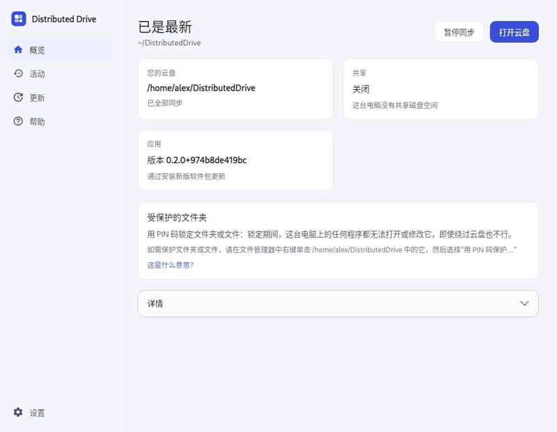
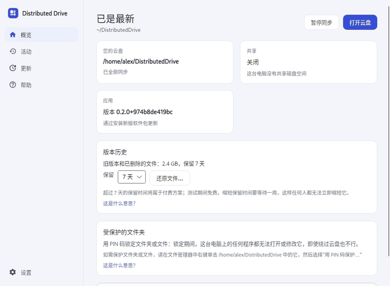
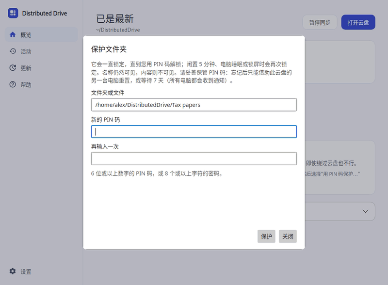

# Distributed Drive 帮助

[English](README.md) · 简体中文

应用中也有同样的帮助：状态 › 帮助。

## 目录

- [您的云盘](#drive)
- [暂停同步](#sync-pause)
- [始终保留在这台电脑上 / 释放空间](#keep-free)
- [共享磁盘空间](#sharing)
- [关闭共享或移除磁盘](#leaving-disk)
- [其他电脑如何连接您的电脑](#relay)
- [用更大的块重新存储旧文件](#repack)
- [版本历史](#versions)
- [勒索软件防护](#ransomware)
- [受保护的文件夹](#protected-folders)
- [保护好您的文件](#keep-safe)
- [您的恢复密钥](#recovery-secret)
- [每月恢复检查](#restore-check)
- [更新](#updates)
- [问题报告和诊断信息](#diagnostics)
- [您的隐私](#privacy)
- [语言](#languages)
- [常见问题](#faq)

## 您的云盘

**您的云盘是一个存放您文件的文件夹（在 Windows 上是一个盘符）。文件在这台电脑上加密，并存放在共享存储的电脑上，所以您可以在自己的任何一台电脑上打开它们。您打开的文件会占用这台电脑的一些磁盘空间。**

在 Windows 上，您的云盘在文件资源管理器中显示为“Distributed Drive”，有自己的盘符。在 Linux 上，它是您在设置向导中选择的文件夹（“文件显示的位置”）。您可以像使用其他文件夹一样使用它。

**保存时会发生什么。** 文件先保存在这台电脑上，所以您可以马上继续工作。之后它会被加密并上传。每个文件都存为两份副本，放在两台不同的电脑上（或者分成几部分存放，其中一部分就足以读取它）。没有任何等待上传的内容时，托盘会显示“已是最新”。有些界面把云盘存放在网络上的这一部分称为“云端”。

**只在网络上，还是在这台电脑上。** 每个文件都会显示在文件夹中，但只有您打开的文件才会被下载。您打开过的文件会在这台电脑上留一份副本，最多占用磁盘的十分之一（至少 2 GB，最多 50 GB）。空间用满后，最久没有使用的副本会先被删除，这些文件又变回只在网络上：打开其中一个就会重新下载它。

- Windows：在文件资源管理器的“属性”列中，“O”表示文件只在网络上，“P”表示文件保留在这台电脑上。
- GNOME 文件管理器会在只在网络上的文件上显示一朵云，在保留的文件上显示一个勾。

## 暂停同步

**暂停同步会让这台电脑停止发送它的更改，直到您恢复同步。您的文件在这里照常可用，您保存的内容会安全地留在这台电脑上等待。不会丢失任何内容，但在您恢复同步之前，您的其他电脑看不到您的更改。**

在应用的菜单中选择 **暂停同步**（在 Windows 上，右键点击时钟旁边的 Distributed Drive 图标；在 Linux 上，点击顶栏中的图标），然后选择时长：

- 30 分钟、1 小时、2 小时或 8 小时
- 直到明天早上 8 点
- 直到我手动恢复

暂停期间，托盘会显示“同步已暂停”以及有多少更改在等待。您仍然可以打开文件，您保存的文件也会继续存到这台电脑上。在此期间，您选择保留在这台电脑上的文件不会被下载。

到了您选择的时间，同步会自动恢复。如需提前恢复，请在菜单中选择 **恢复同步**；等待中的更改会按您做出的先后顺序上传。

同一菜单中的 **暂停共享** 对共享的作用相同：暂停期间，这台电脑不再接收新的数据片，但仍会为已保存的数据片提供服务。

注意：如果是勒索软件警报暂停了同步（“已暂停同步以保护您的文件”），恢复同步无法解除它。请参阅“勒索软件防护”。

## 始终保留在这台电脑上 / 释放空间

**选择哪些文件和文件夹始终留在这台电脑上，这样没有网络也能打开；又有哪些把空间还回来。保留的文件会占用这台电脑的磁盘；释放空间不会从您的云盘中删除任何内容。**

在云盘中右键点击一个文件或文件夹：

- Windows：右键点击，然后选择 **显示更多选项**（Windows 11）。
- Linux：GNOME 文件管理器或 Nemo 的右键菜单；在 Dolphin 和 Thunar 中，位于 **Distributed Drive** 下。

**始终保留在这台电脑上** 会立即在后台下载它，并把它保留在这里。保留一个文件夹会包括其中的所有内容，也包括您的其他电脑以后添加到其中的文件。

**释放空间** 会删除这台电脑上的副本。文件仍在您的云盘中和您的其他电脑上；打开它就会重新下载。正在打开的文件，或还有更改在等待上传的文件，会保留副本，直到处理完毕。

您可以对保留的文件夹中的某个文件或文件夹释放空间：其余部分仍然保留。

这些选择只对这台电脑有效；您的每台电脑都有自己的选择。

**空间。** 云盘始终保留磁盘的十分之一空闲（至少 2 GB），另留 1 GB 用于保存。放不下的保留文件会只存放在网络上，直到腾出空间为止，“状态”会显示“部分保留的文件在这台电脑上放不下”。如需腾出空间，请对不需要离线使用的保留文件释放空间，或删除这个磁盘上的其他内容。

## 共享磁盘空间

**拿出这台电脑的一部分空闲磁盘空间，存放别人的文件和您自己的文件的加密数据片。存放数据片的人都无法读取它。登录期间，这会占用磁盘空间和您的一部分网络带宽。**

在 设置 › 共享存储 中开启。选择一个磁盘、该磁盘上存放数据片的文件夹，以及共享多少：

- **固定大小**，以 GB 为单位；
- **磁盘的一部分**，在 1% 到 90% 之间；
- **全部空闲空间**。

无论您怎么选，磁盘的十分之一（至少 2 GB）始终为您保留空闲。超过这一点，共享就不再接收新的数据片。

**多个磁盘。** 选择 **+ 添加磁盘**，即可共享这台电脑的另一个磁盘，它有自己的文件夹和共享大小。一个文件的两份副本绝不会放在同一台电脑的两个磁盘上，所以这样做提供的是更多空间，而不是更高的安全性。

**共享可以占用这台电脑多少资源：**

- **均衡：共享以低优先级运行（推荐）**；
- **优先我的电脑：共享每个方向最多使用 10 Mbit/s**；
- **收益最大化：不限制**。

设置 › 高级 中有精确的上传和下载限制，以及不限速的时段。

**别人能看到什么、看不到什么。** 您磁盘上的数据片都是加密的：任何人都打不开。与您的电脑交换数据片的电脑能看到它的网络地址。它们永远看不到您的文件名或文件内容。

共享只在您登录期间运行。这个文件夹必须位于这台电脑内部的磁盘上，不能在网络共享上，也不能在您的云盘中。

## 关闭共享或移除磁盘

**共享的磁盘停止之前，它的数据片会迁到其他电脑，所以不会有文件失去副本。这可能需要几个小时。您也可以提前停止，但另一份副本缺失的文件随后可能无法读取。**

当您关闭共享，或在 设置 › 共享存储 中选择 **移除这个磁盘** 时，磁盘会在数据片迁出期间继续共享。“状态”和托盘会显示进度（“正在把 … 迁出 D: — 40%”），并显示一辆搬家卡车。全部迁出后，磁盘会自动停止，其文件夹中的数据片会被删除，“状态”会显示“磁盘已迁出”。该文件夹中您自己的文件不会受到影响。

迁出期间，“状态”提供两个按钮：

- **继续共享这个磁盘** 会取消迁出：磁盘像以前一样继续共享。
- **仍然立即停止** 会先告诉您停止会带来什么风险。要么显示“可以安全停止：D: 上的每个数据片都有另一个副本”，要么显示有多少数据片只存在于这个磁盘上。然后选择 **等待** 或 **仍然停止**。只存在于这里的数据片会被优先迁出，所以多等一会儿往往就能安全停止。

“自 … 起没有进展”表示接收数据片的电脑可能已关机。之后会自动继续。

坏掉或已不存在的磁盘会被立即移除：网络会用其他副本重建它的数据片。

在 Windows 上，如果在共享期间卸载，会先询问您：**先迁出数据片（可能需要几个小时）** 或 **仍然卸载**。

## 其他电脑如何连接您的电脑

**其他电脑需要连接您的电脑，才能存放和取回数据片。直接连接最快；否则它们会通过服务的中继连接，速度较慢。您也可以帮助彼此无法连接的电脑。**

“状态”（共享）会显示其他电脑如何连接这台电脑：

- **可直接连接**：其他电脑直接连接到它。这是最好的情况。
- **只能通过服务的中继**：所有数据都经过服务，速度较慢。您的路由器没有让其他电脑连进来。

**改为直接连接。** 设置 › 高级 中有 **让我的路由器转发端口（UPnP）**，默认开启：应用会请您家里的路由器打开这个端口。如果您的路由器不支持，而您又熟悉自己的路由器，可以自己设置：把 TCP 端口 7444 转发到这台电脑（端口显示在“设置”中），或在路由器上开启 UPnP。每多共享一个磁盘，就使用下一个端口（7445、7446…）。在某些网络上（移动数据、部分网络服务商）无法做到：这时中继会继续工作。

**帮助其他电脑连接（在上传限制内为它们中继）。** 如果其他电脑能直接连接这台电脑，您可以在 设置 › 高级 中勾选此项。这台电脑随后会在彼此无法连接的电脑之间转发数据，这样数据就不必经过服务。除非您勾选，否则它是关闭的。它转发的数据计入您的共享上传限制（如果您没有设置，则为 10 Mbit/s）。它只转发加密数据：它无法读取任何内容。

## 用更大的块重新存储旧文件

**重新存储在启用更大的块之前保存的文件，让它们在网络上占用的数据片少得多。只在云盘的一台电脑上开启。它每个方向最多使用 10 Mbit/s，可能会运行好几天。**

较早的文件被存成了许多小数据片。此选项会读取每个这样的文件，再用更大的块重新存储，内容、名称和日期都完全相同。您的文件不会有任何改变。

在 设置 › 云盘 中开启：**用更大的块重新存储旧文件（只在此云盘的一台电脑上开启；会连续数天每个方向最多使用 10 Mbit/s）**。如果两台电脑同时这样做，就会把同样的文件上传两次。

- 它一次处理一个文件，而且始终先处理您自己保存的内容。
- 不在这台电脑上的文件会为此被下载，但不会把您自己的文件挤出这台电脑存放副本的空间。
- 在同步暂停、离线，或您的某台电脑需要更新时，它会等待。“状态”会说明这一点。
- 您的其他电脑不会重新下载任何内容，但它们保留在本机上的文件除外。

“状态”会显示它正在做什么（“正在用更大的块重新存储旧文件：3 个文件…”），完成后会显示“已全部完成”。随时取消勾选即可停止。

## 版本历史

**每个被替换和删除的文件都会保留 7 天，所以您可以把一个文件、一个文件夹或整个云盘还原到以前的样子。在操作失误或遭遇勒索软件之后使用。它是免费的；不占用您电脑上的空间。**

每次保存都会保留，而不只是每天一次。这些版本由服务保存，所以一台电脑上出了问题也无法删除它们。

**保留多久。** 所有人都是 7 天。以后会在付费方案中提供更长的保留时间。“状态”中的“版本历史”卡片会显示旧版本占用多少空间，并有 **保留** 选项。缩短保留时间或不保留，要在一周之后才生效，所以没有人能立即缩短它。

**还原文件…**（在“状态”和应用的菜单中）：

1. 选择整个云盘、一个文件夹或一个文件。
2. 选择要还原到的日期和时间。
3. 选择 **还原**。

从那时起被改动或删除的内容会恢复回来。之后新建的文件保持不变。不会上传任何内容：旧版本本来就还存放着。还原本身也可以用同样的方法撤销。您无法还原到比版本保留天数更早的时间。

**以前的版本…** 在 Windows 上，在云盘中右键点击一个文件，然后选择 **显示更多选项** › **以前的版本…**：“还原文件”窗口会打开，并已选中该文件。在 Linux 上，请使用“还原文件…”并选择该文件。

## 勒索软件防护

**勒索软件是一种通过加密来锁住您文件的程序。Distributed Drive 会监视它，阻止它波及您的云盘，并帮助您还原文件。接下来怎么做由您决定。**

**在这台电脑上。** 当文件以勒索软件的方式被改动时（10 个文件，在 2 分钟内或一天内），同步会立即停止：“已暂停同步以保护您的文件”。更改仍会存到这台电脑上，但不会再有任何内容进入您的云盘。云盘顶层隐藏的诱饵文件有助于及早发现它：请不要动它们。在“状态”中：

- **还原我的文件**（会先询问您）：警报之后被改动的文件会恢复为云盘中的样子。请先用杀毒软件进行全盘扫描。
- **查看改动内容** 会列出这些文件。
- **是我做的，继续**：仅当这是您自己做的（例如有意加密文件）时才选择。

**服务的冻结。** 如果一台电脑在一小时内改写或删除了至少 100 个文件，而且这占云盘的五分之一，或是它最忙的一小时的 10 倍（如果是新电脑：五分之一，且 300 个文件），服务就会冻结它的更改。您的另一台电脑可以立即解除冻结（**解除冻结**）。在被冻结的电脑上，**解除冻结（需要一周）…** 需要恢复密钥，因为那台电脑上的恶意软件能做到您能做的一切。

**复制。** 如果一个程序下载了许多不在这台电脑上的文件（10 分钟内超过 50 个，或一天内超过 500 个），它每秒只能拿到一个，并且会询问您：**今天允许** 还是 **阻止这个程序**。

以上每种情况都会通知您的其他电脑。另请参阅“版本历史”和“受保护的文件夹”。

## 受保护的文件夹

**用 PIN 码锁住您最重要的文件夹或文件。锁定期间，任何电脑上的任何程序都无法打开或修改它，勒索软件也不例外。每次打开它都需要 PIN 码。**

**保护。** 在云盘中右键点击一个文件夹或文件，然后选择 **用 PIN 码保护…**（Windows：先选择 **显示更多选项**；Linux：GNOME 文件管理器、Nemo、Dolphin 或 Thunar）。请使用 6 位或更多数字的 PIN 码，或 8 个或更多字符的密码。您云盘的每台电脑都必须先运行这个版本。

**锁定和解锁。** 名称仍然可见；内容不可见。可以在同一菜单中、在“状态”中或在应用的菜单中（受保护的文件夹）用 **解锁…** 解锁。它只在这台电脑上解锁，并会在 5 分钟未使用、这台电脑睡眠、屏幕锁定或您注销时再次锁定。**锁定** 会立即锁住它。在文件资源管理器、GNOME 文件管理器、Nemo 和 Dolphin 中，文件夹上会显示一把锁。

把文件移进或移出时，实际上是复制它们。PIN 码由服务检查，所以小偷无法一直猜下去：输错 5 次 PIN 码后，您需要等待一小时，之后每再错一次，等待时间都会更长。

**忘记 PIN 码。** 在“状态”中选择 **忘记 PIN 码…**。在您云盘的另一台电脑上批准重置，或等待 7 天；每台电脑都会收到通知，并可以 **取消重置**。然后选择一个新的 PIN 码。如果您的云盘只在一台电脑上，会先要求输入恢复密钥，这样使用您电脑的其他人无法重置 PIN 码。

**取消保护…**（在解锁状态下）：文件留在原处，但不再需要 PIN 码，也不再锁定。

## 保护好您的文件

**“状态”中的一份清单，列出这台电脑可以做些什么来保护您的文件。每一项完成后会显示一个勾，否则会显示一个按钮让您去完成。不会通过网络检查任何内容。**

**保护好您的文件** 卡片列出：

- **版本历史已开启。** 被替换和删除的文件会被保留，所以被勒索软件改动的内容可以用“还原文件…”还原。
- **您的恢复密钥已妥善保管。** 如果所有电脑都丢失，这是重新打开云盘的唯一方法；任何拿到它的人都能打开您的文件。请把它写在纸上，存放在这台电脑以外，然后选择 **我已妥善保管**。
- **已有 1 个文件夹用 PIN 码保护。** 锁定期间，电脑上的任何程序都无法打开或修改它。在云盘中右键点击您最重要的文件夹，然后选择 **用 PIN 码保护…**（Windows：在“显示更多选项”下）。
- **更新会自动安装。** 每次更新都可能堵住一条入侵途径。在 Windows 上，不要让更新一直处于暂停状态；在 Ubuntu 上，请在系统设置中保持自动更新开启。**更新…** 会打开应用的更新页面。

全部完成后，卡片会显示：“这里的事项都已完成。您其他电脑的杀毒软件和更新同样重要。”请在您使用云盘的每台电脑上开启杀毒软件，并保持它为最新。

## 您的恢复密钥

**恢复密钥可以打开您云盘中的文件。如果您的所有电脑都丢失，这是重新打开云盘的唯一方法。任何拿到它的人都能打开您的文件，所以请把它写在纸上，存放在安全的地方。**

它由 16 组、每组 4 个字符组成，例如 1A2B-3C4D-…，只在您创建云盘时显示一次。没有其他人拥有它，服务也没有。如果您丢失了它和所有电脑，任何人都无法打开您的文件。

- 把它写在纸上，存放在远离您电脑的地方，或保存在密码管理器中。
- 在旁边写下 **云盘编号**（显示在同一画面中，也显示在“状态”中）：从新电脑加入时，两者都需要。
- 如果您复制了它，请立即粘贴到密码管理器中，然后再复制点别的内容。

**添加另一台电脑。** 在那台电脑上安装 Distributed Drive。在它的设置向导中，选择以下之一：

- **与已有云盘的另一台电脑配对：无需输入密钥。** 新电脑会显示一个配对编号（例如 ABCDE-FGHJK）。在已有您云盘的电脑上，从应用的菜单中选择 **添加另一台电脑…** 并输入这个编号。然后输入新电脑显示的 6 位代码，再在新电脑上输入另一台电脑显示的 4 位代码。只有在您自己的电脑就在面前时才这样做。服务会转交您的云盘，但无法打开它。
- **加入我在另一台电脑上已在使用的云盘**：输入云盘编号和恢复密钥。

## 每月恢复检查

**每月一次，应用会检查您的文件是否真的能从共享存储的电脑上恢复回来。它会自动运行，占用少量网络带宽。如果发现问题，“状态”会说明是哪些文件以及该怎么做。**

从未试过恢复的备份只是一种希望。所以您云盘的每台电脑每月一次从共享存储的电脑上读回（从不读它自己的副本）：

- 每个文件和文件夹的描述信息；
- 随机抽取的一部分文件，最多 1 GB，完整打开并检查。

它在电脑在线、没有等待上传的内容并且接通电源时运行（使用电池时会等待）。在此期间，您自己的工作照常进行。“状态”会显示结果，例如“上次恢复检查：10月3日 — 所有文件都能打开（321 个文件，读回 1.1 GB）”。

**如果有文件可能无法恢复。** “状态”会显示“1 个文件可能无法恢复”（或具体数量），并列出文件名。该怎么做：

1. 如果您在别处有副本，请把它重新复制到云盘中。
2. 或者用“还原文件…”还原一个较早的版本。
3. 如果这种情况反复出现，请从“设置”发送诊断信息。

很多时候，保存这些文件的电脑只是关机了：等它们开机后，文件就能恢复。

## 更新

**应用会自动保持最新，让修复和防护措施及时送到您手上。它会在没有上传任务时安装更新，并自动重新启动。您可以暂停更新一段时间。**

**Windows。** 应用会检查新版本并下载。它会在没有上传任务时安装，并在 5 分钟前用通知告诉您（“Distributed Drive 将在 5 分钟后更新到 …”）。云盘会短暂停止，应用安装更新，然后自动重新启动。在更新下载、等待或安装期间，以及在您看过 **新功能** 之前，托盘图标上会显示一个小圆点。请在更新安装前关闭您在云盘上打开的文件：即使文件还开着，云盘也会停止。

在 状态 › 更新 中：**立即安装**、**检查更新**、**以后再说（4 小时）**、**暂停更新一天**、**暂停更新一周** 和 **恢复更新**。标记为必需的更新即使在暂停期间也会安装。应用只安装经过签名的更新，并在使用前进行检查。

**Ubuntu。** Ubuntu 会和您的其他软件一起安装 Distributed Drive 的更新（软件更新器，或自动更新）。更新后，一旦没有正在传往云盘的内容，应用就会关闭并自动重新启动。如需暂停，请在软件更新器中推迟这次更新。状态 › 更新 会显示您的版本以及每个新版本带来了什么。

## 问题报告和诊断信息

**出现问题时，应用可以发送它的日志（已移除名称和密钥），以便找到并修复问题。您可以关闭自动报告。“发送诊断信息…”会先让您看到它要发送的内容。**

**自动问题报告。** 当应用崩溃、云盘或共享意外停止，或在云盘上复制文件反复失败时，应用会自动发送问题报告，最多每 6 小时一次。报告服务器会保留 30 天。在 设置 › 常规 中用 **自动发送问题报告** 关闭或开启此功能。

**发送诊断信息…**（设置 › 常规）用于应用没有发现的问题。它会让您看到文件中的确切内容，然后：

- **发送给支持人员** 会发送它，并显示一个报告代码，例如 7F3A-91C2。请把这个代码告诉为您提供帮助的人。
- 或者 **打开文件夹**，自己发送这个文件。

即使关闭了自动报告，它也能使用。

**报告中包含什么：** 应用最近的日志和状态，其中文件和文件夹名称已转换为代码，已移除这台电脑的名称，网络地址已缩短，且不含任何密钥或电子邮件地址。

**反馈。** **建议功能或发送反馈…**（在应用的菜单中，以及 设置 › 常规 中）会把几句话发送给团队；只有在您希望得到回复时，才会附上您的电子邮件地址。这台电脑上的其他任何内容都不会随之发送。

## 您的隐私

**您的文件在离开这台电脑之前，就已在这台电脑上加密。服务只负责协调：它无法打开您的文件。本页概括了隐私声明；声明全文在应用的菜单中。**

**留在这台电脑上的内容：** 您的恢复密钥、文件的内容和名称（它们只以加密形式离开），以及应用的日志（只有问题报告或“发送诊断信息”才会发送其中的内容）。

**服务为了正常工作而接收的内容：**

- 这台电脑的网络地址和端口；
- 这个应用的一个随机编号，绝不包括电脑的名称；在您共享存储时，共享的一个随机编号，以及根据这台电脑系统自身编号经单向编码生成的电脑编号（重新安装应用后保持不变）；
- 应用的版本，以及这台电脑配置的简短描述，用于修复特定电脑上的问题：它的系统、处理器类型、哪些网络功能可用，以及几个软件的版本（绝不包括它的名称、型号或序列号）；
- 加密数据片的大小，以及哪些电脑保存着它们；
- 您共享存储时，共享多少空间以及运行是否正常。

**位置。** 服务的服务器位于马来西亚境外；隐私声明中列出了具体国家。应用在使用任何其他国家的服务器之前，会再次征求您的同意。共享存储的电脑也可能位于其他国家：它们保存您文件的加密数据片，并能看到这台电脑的网络地址。

**问题报告和诊断信息：** 请参阅“问题报告和诊断信息”。**更新：** 更新服务器能看到这台电脑的网络地址和应用的版本；新版本从 GitHub（或更新服务器）下载，GitHub 能看到这台电脑的网络地址。

您可以在应用的菜单中用 **查看隐私声明…** 再次阅读隐私声明。

## 语言

**选择应用的窗口、菜单和消息所用的语言。“自动”会跟随这台电脑的语言。更改语言是免费的。**

在 设置 › 常规 中，**语言** 提供：

- **自动**：这台电脑的语言为简体中文时使用中文，否则使用英文（繁体中文系统目前使用英文）。
- **English**（英文）。
- **简体中文**。

保存后应用会立即换成新语言：包括它的窗口和托盘菜单，在 Windows 上还包括文件资源管理器菜单中的项目。在 Linux 上，文件管理器中的菜单项（始终保留在这台电脑上、用 PIN 码保护… 等）也会跟着改变，在您下次打开菜单时生效。

状态 › 详情 保持英文：这是供为您提供帮助的人阅读的技术信息。

## 常见问题

**对大家最常问的问题的简短回答。每个回答都指向内容更详细的主题。**

**如果一台共享存储的电脑被偷，我的数据安全吗？**
安全。它只保存加密的数据片，任何人都打不开；而且在它离线 12 小时后，网络会在其他电脑上为这些数据片制作新的副本。如果那台电脑上也有您的云盘，受保护的文件夹会保持锁定；请为这台电脑本身的登录设置密码保护。

**为什么我的上传很慢，或者没有进展？**
大文件在加密期间会先显示“正在准备”，而且每个文件要上传两次（两份副本），所以比只上传一份要花更长时间。“没有进展”通常表示目前在线的共享存储的电脑不够，或者同步已暂停或处于离线状态。在此期间，您的文件安全地保存在这台电脑上，之后会自动完成上传。

**如果我的电脑关机了会怎样？**
您在它上面保存的更改会在它下次开机并联网时上传。如果它共享存储，它保存的数据片在别处都有副本，而且在它关机 12 小时后，网络会制作新的副本。在您的其他电脑上，文件照常可以打开。

**服务能读取我的文件吗？**
不能。文件在离开您的电脑之前就已在您的电脑上加密，而且服务从来没有您的恢复密钥。它只能看到大小、哪些电脑保存着哪些数据片，以及网络地址。

**如何卸载？**
请先等到托盘显示“已是最新”；如果这台电脑共享存储，请关闭共享，并等到“状态”显示磁盘已迁出。然后退出应用并卸载它：在 Windows 上通过 设置 › 应用，在 Ubuntu 上使用 `sudo apt remove distributeddrive`。您的文件仍在您的云盘中和您的其他电脑上；应用自己的文件夹会留在这个磁盘上，直到您删除它们。

**如果我丢失了所有电脑怎么办？**
在一台新电脑上安装 Distributed Drive，选择“加入我在另一台电脑上已在使用的云盘”，然后输入您的云盘编号和恢复密钥。没有恢复密钥，任何人都无法打开您的文件，所以请把它写在纸上。

**如果我忘记了 PIN 码怎么办？**
在“状态”中选择“忘记 PIN 码…”，然后在您云盘的另一台电脑上批准重置，或等待 7 天。如果只有一台电脑，还需要输入恢复密钥。请参阅“受保护的文件夹”。

**共享会让我的电脑变慢吗？**
很少会：选择“均衡”时，共享以低优先级运行。如果您察觉到变慢，请选择“优先我的电脑”（每个方向最多 10 Mbit/s），在 设置 › 高级 中设置限制，或使用“暂停共享”。

**为什么我的云盘显示“离线”？**
这台电脑无法连接服务：请检查它的网络连接。这台电脑上的文件仍然可以打开，您的更改会保存在这里，等重新联网后再上传；只在网络上的文件在那之前可能无法打开。
